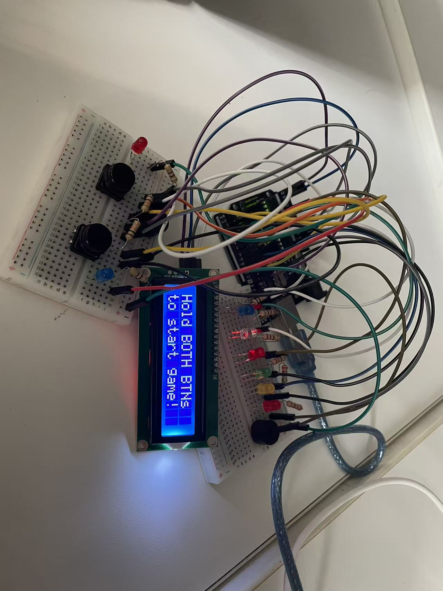

# Reaction Time Game

**Platform:** Arduino Uno · **Development Environment:** Arduino IDE · **Language:** Arduino/C++

Reaction Time Game is a two-player physical arcade game developed during Cooper Union Summer STEM 2026. Two players compete by pressing their buttons as quickly as possible after an unpredictable audio signal. The system measures both reaction times, determines the winner of each round, and turns a simple electronic circuit into a competitive and replayable experience.

The project was created to explore how timing, physical interaction, and immediate feedback can make an electronics project engaging. Instead of relying only on numerical results in the Serial Monitor, the game communicates through illuminated LEDs, two buzzers, and push buttons. This combination allows players to understand the game state without constantly looking at a computer and makes the prototype feel more like a complete standalone product.

  

Each match contains five rounds. At the beginning of a round, the Arduino waits for a randomized amount of time before playing the start signal. Pressing too early is treated as a false start and awards a point to the other player. After the signal, the program records each player's response in milliseconds. The faster player receives between one and five points depending on the winning margin, while an exact tie awards no points. LEDs identify the round winner and visualize the points earned, and rising tones provide additional feedback.

The game uses an Arduino Uno, two push buttons, two player LEDs, five score LEDs, two passive buzzers, resistors, breadboards, and jumper wires. The photographed prototype also includes a 16×2 LCD module used during development. The circuit and program were developed and tested in Arduino IDE. The code demonstrates digital input with internal pull-up resistors, millisecond-based timing, random delays, state control, score calculation, false-start detection, LED animation, tone generation, serial debugging, and the coordination of several output devices within one interactive system.

The working prototype and core gameplay logic have been completed and tested. The current version supports automatic round progression, response-time comparison, score calculation, timeout handling, false-start penalties, round feedback, a final victory sequence, and button-controlled restart. Future improvements could include a custom enclosure, cleaner permanent wiring, adjustable difficulty, a best-reaction-time record, and a more detailed LCD interface.

AI tools were used to assist with parts of the coding process and documentation. My responsibilities included debugging and refining the code, designing and completing the circuit wiring, assembling the breadboard prototype, integrating the physical components, testing the hardware, and troubleshooting the complete system. The gameplay decisions and final implementation were completed and reviewed by me.

The project demonstration video will be added after compression is complete.
